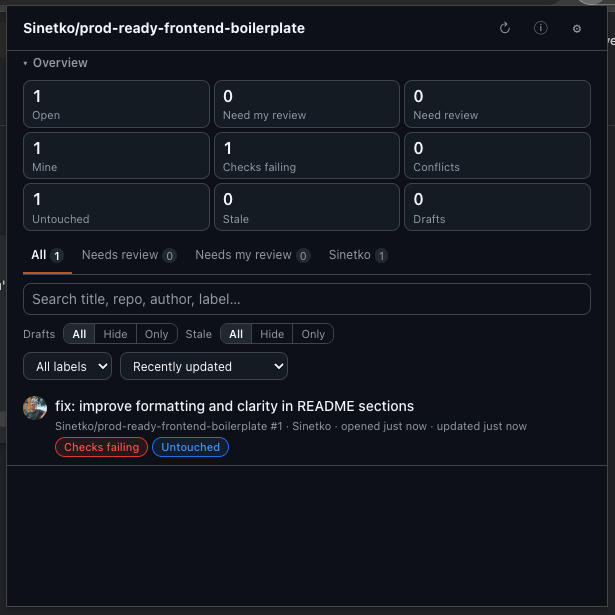
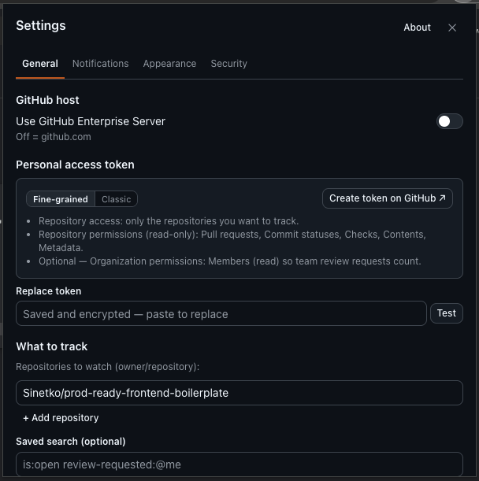
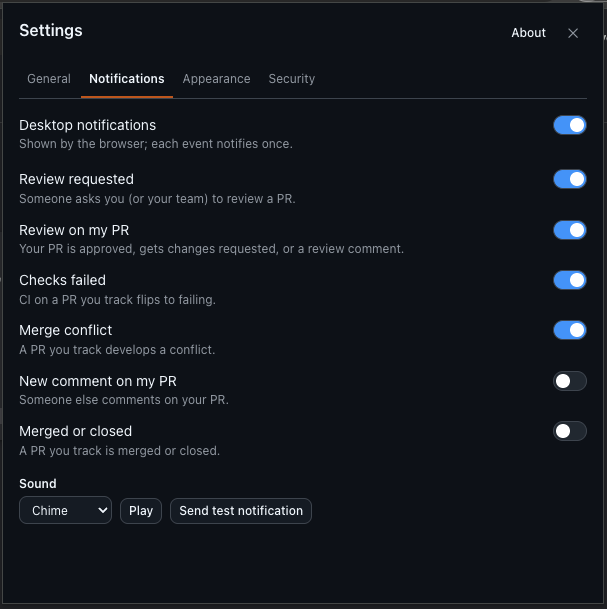
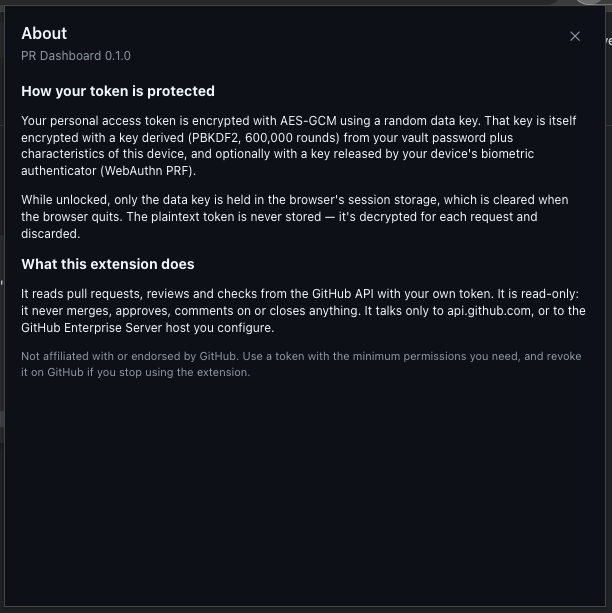
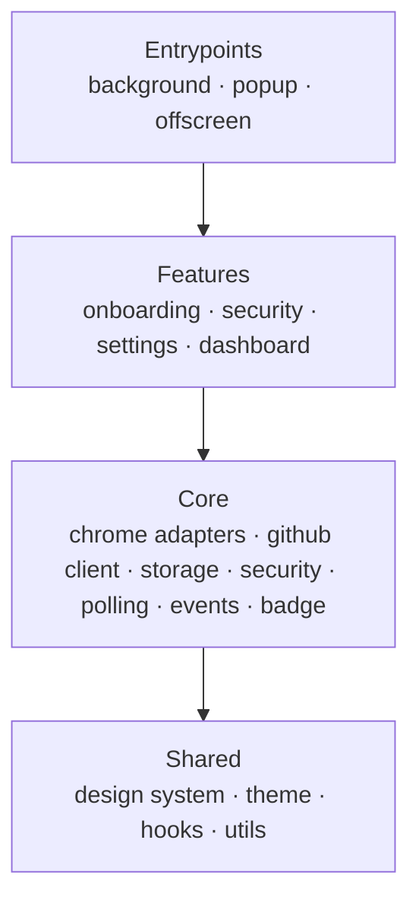

# GitHub PR Dashboard

**A Chrome extension that tells you which pull requests need you right now: across repositories,
with CI status, merge conflicts, desktop notifications and a toolbar badge.**


<table>
  <tr>
    <td></td>
    <td></td>
  </tr>
  <tr>
    <td align="center"><sub>Dashboard: overview, tabs, filters, status pills</sub></td>
    <td align="center"><sub>Connection settings with inline token guidance</sub></td>
  </tr>
  <tr>
    <td></td>
    <td></td>
  </tr>
  <tr>
    <td align="center"><sub>Per-event notifications with sound</sub></td>
    <td align="center"><sub>Plain-language security model</sub></td>
  </tr>
</table>

## Why

GitHub's own notifications mix everything together. Reviewers miss requests, authors miss failing
CI, and PRs go stale. This extension keeps one focused view of the PRs you care about. It works for
any GitHub.com account with a personal access token, and for GitHub Enterprise Server. It is
strictly **read-only**: it never merges, approves, comments on or closes anything.

## Features

- **Multi-repository tracking**: explicit `owner/repo` entries or a saved GitHub search
  (e.g. `is:open review-requested:@me`), with a source switcher.
- **Views**: All / Needs review / Needs my review / per author, with draft and stale filters
  (all · hide · only), a label filter, live search and sorting.
- **Status at a glance**: draft, needs review, needs my review, untouched, merge conflicts,
  checks failing or running, stale, approval progress (`1/2 approved`) and unresolved review
  threads.
- **Background sync** on a configurable interval, with an instant, cache-first popup.
- **Toolbar badge**: your review queue, with separate states for "locked" and "can't reach GitHub".
- **Desktop notifications**, each type toggleable and deduplicated, with an optional sound: review
  requested, review received, checks failed, merge conflict, new comment, merged/closed.
- **Themes**: light, dark, dimmed, high-contrast, or follow the system setting.
- **Enterprise-ready**: GitHub Enterprise Server host support with a per-origin runtime
  permission request.

## Engineering highlights

### Client-side security, done properly

The personal access token is protected by **envelope encryption**:

```
PAT ──AES-GCM──▶ ciphertext            (data key: random AES-256)
data key ──wrapped by──▶ PBKDF2-SHA256(600k rounds, device fingerprint + password)
data key ──wrapped by──▶ HKDF(WebAuthn PRF output)          ← optional Touch ID / Windows Hello
```

- The password is mandatory and policy-checked. A wrong password and a different device fail in
  exactly the same way (the AES-GCM tag check), so there is no separate password oracle.
- Every ciphertext is bound to its slot with **AES-GCM associated data**, so encrypted blobs
  can't be swapped between slots.
- While unlocked, only the raw data key lives in `chrome.storage.session`, which is cleared when
  the browser quits. The plaintext token is **never persisted**: it's decrypted for each API
  call and then discarded.
- The device fingerprint deliberately leaves out values that change during normal use (browser
  and OS build numbers, timezone, language), so updating the browser or travelling never locks a
  user out.
- A half-filled settings form survives the native permission prompt closing the popup. The
  draft is persisted without the token; the typed token is stored separately, encrypted with the
  session key.

### Efficient use of the GitHub API

- **Two-phase sync**: a conditional REST request (`If-None-Match`) detects _whether_ anything
  changed; an unchanged list returns `304`, which doesn't count against the rate limit. Then one
  **GraphQL batch query** hydrates only the PRs that changed. No N+1 fan-out.
- **Knows the API's quirks**: a CI run finishing doesn't bump a PR's `updated_at`, and GitHub
  computes mergeability asynchronously. PRs with running checks or unknown mergeability are
  re-fetched every cycle, even when the list returns `304`.
- **Saved searches** use server-side `updated:>=` deltas, and a periodic full reconcile catches
  what deltas and ETags can't see.
- **Rate limits are handled, not retried**: primary and secondary limits become typed errors,
  polling pauses until the reset time, and the UI shows "resuming at HH:MM".
- Required-approval counts come from branch rulesets, falling back to classic branch protection
  and degrading gracefully when the token can't read either.

### Built for Manifest V3's constraints

- Polling runs on `chrome.alarms` with **no module-level state**. Every wake-up re-reads what it
  needs from storage, so service-worker suspension is a non-event.
- Sources are polled **sequentially, each isolated**. One broken repository can't block or
  corrupt another, and results are persisted per source as they arrive.
- Sound plays through a lazily created, race-tolerant **offscreen document**, because service
  workers have no `<audio>`.
- Notifications are deduplicated with a persisted ledger. Click routing is stateless (the PR URL
  is recovered from the notification id).

### Architecture enforced by tooling, not by convention



- A strict one-way dependency flow. Features never import each other; cross-feature UI is
  composed in the popup through slots.
- **Only** `core/chrome` may touch `chrome.*`, and **only** `core/github` may call `fetch()`.
  Everything above works with typed, validated domain objects.
- These rules, plus import cycles, are enforced by ESLint and a path-resolving boundary checker.
  A manifest audit fails the build on wildcard host permissions or unused permissions.
- Every read from storage is parsed field by field against a versioned schema
  (`meta.schemaVersion` + migrations), so corrupt or old data degrades to defaults instead of
  crashing the popup.

### Quality

- **305 tests across 31 suites, 96.6% line coverage**, with enforced thresholds on the
  domain-logic, storage and utility layers.
- In-memory fakes for `chrome.*`, `fetch` (realistic GitHub fixtures covering pagination, `304`
  and partial failures) and **WebAuthn with PRF**. No test touches a real browser API or the real
  GitHub API.
- An **end-to-end smoke test** loads the built extension into real Chromium. It walks onboarding
  with real WebCrypto, verifies that no plaintext secret ever reaches storage, performs a
  lock → unlock round-trip, and syncs against a mocked GitHub all the way to the dashboard and
  badge.
- TypeScript `strict` plus `noUncheckedIndexedAccess` and `exactOptionalPropertyTypes`. No `any`
  and no non-null assertions.
- Accessible components: tabs with roving focus and arrow keys, labelled form controls,
  `aria-live` status banners, reduced-motion support.

## Tech stack

React 19 · TypeScript · Vite 8 + CRXJS · styled-components · Zustand · Web Crypto API · WebAuthn
PRF · GitHub REST + GraphQL · Vitest + Testing Library · Playwright · ESLint (flat config) +
Prettier + Husky · pnpm

## Getting started

```sh
pnpm install
pnpm build
```

Open `chrome://extensions`, enable **Developer mode**, click **Load unpacked** and select `dist/`
(Chrome 127+). The first run walks you through: welcome → vault password → optional biometric
unlock → token and repositories → dashboard.

### Token permissions

| Token        | Minimum                                                                                                      | Optional                                              |
| ------------ | ------------------------------------------------------------------------------------------------------------ | ----------------------------------------------------- |
| Fine-grained | Access to the tracked repositories; read-only **Pull requests, Commit statuses, Checks, Contents, Metadata** | Organization **Members: read** (team review requests) |
| Classic      | `repo` (or `public_repo` for public repositories only)                                                       | `read:org` (team review requests)                     |

The settings screen links straight to the matching GitHub token page and explains these scopes
inline. **Test** verifies the token before you save.

### Extension permissions

| Permission                 | Purpose                                                                                     |
| -------------------------- | ------------------------------------------------------------------------------------------- |
| `storage`                  | Settings, encrypted vault, cache                                                            |
| `alarms`                   | Background polling that survives service-worker suspension                                  |
| `notifications`            | Desktop notifications                                                                       |
| `offscreen`                | Notification sounds                                                                         |
| `https://api.github.com/*` | The GitHub API                                                                              |
| optional `https://*/*`     | Lets a user-entered Enterprise host be requested; only that single origin is ever asked for |

## Development

```sh
pnpm dev          # dev build with HMR
pnpm verify       # typecheck → lint → layer boundaries → tests → build → manifest audit
pnpm coverage     # tests with enforced coverage thresholds
pnpm e2e:smoke    # real Chromium + unpacked build + mocked GitHub (run `pnpm build` first)
pnpm generate component src/shared/ui/my-component   # scaffold a component/hook/store
pnpm assets       # regenerate the bundled icons and notification sounds
```

The icons and sounds are generated procedurally by scripts in `scripts/`, so the project ships no
third-party assets.

```
src/
├── background/   service worker: alarms, polling, notifications, badge
├── popup/        composition root: services + onboarding stage router
├── offscreen/    audio playback document
├── features/     onboarding · security · settings · dashboard
├── core/         chrome adapters · github client · storage · security · polling · events · badge
├── shared/       design-system components · themes · hooks · utils
└── test/         chrome, fetch and WebAuthn fakes, fixtures
```

---

Not affiliated with or endorsed by GitHub.
